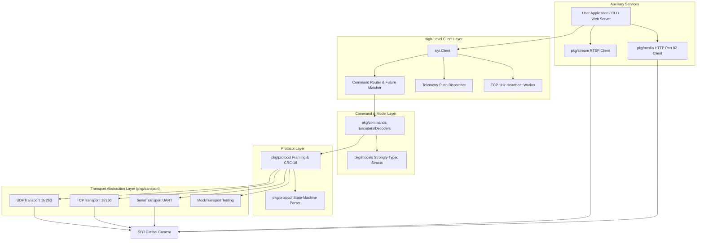

# siyi-sdk-go

[](https://github.com/hitraa/siyi-sdk-go/actions/workflows/ci.yml)
[](https://goreportcard.com/report/github.com/hitraa/siyi-sdk-go)
[](https://pkg.go.dev/github.com/hitraa/siyi-sdk-go)
[](LICENSE)

An idiomatic, high-performance, and production-grade **Go SDK** for **SIYI Optical & Thermal Gimbal Cameras** implementing the **SIYI Gimbal Camera External SDK Protocol v0.1.1**.

Engineered adhering strictly to **SOLID design principles**, `siyi-sdk-go` provides a clean layered architecture, robust state-machine protocol parsing, zero-allocation CRC-16/XMODEM verification, resilient multi-transport connectivity (UDP, TCP, UART Serial), pure-Go RTSP streaming, TF card media HTTP API support, and a responsive embedded real-time Web UI Dashboard.

---

## Supported Hardware & Cameras

Compatible with all SIYI optical and thermal gimbal cameras:

| Camera Model | Protocol Support | Optical Zoom | Thermal Sensor | Laser Rangefinder | AI Tracking |
| :--- | :---: | :---: | :---: | :---: | :---: |
| **ZT30** | Full | 30x Hybrid | Yes (640x512) | Yes (1000m) | Yes |
| **ZT6** | Full | 6x Hybrid | Yes (640x512) | No | Yes |
| **ZR30** | Full | 30x Optical | No | No | Yes |
| **ZR10** | Full | 10x Optical | No | No | No |
| **A8 mini** | Full | 6x Digital | No | No | Yes |
| **A2 mini** | Full | Wide Angle | No | No | No |
| **Quad-Spectrum** | Full | Optical + IR | Yes (Multi) | Yes | Yes |

---

## Key Features

- **Layered SOLID Architecture**:
  - `pkg/protocol`: Binary framing, state-machine streaming parser, and CRC-16/XMODEM table lookup.
  - `pkg/models`: Strongly-typed domain models, angle constraints, and firmware version decoders.
  - `pkg/commands`: Over 75 command serializers and deserializers.
  - `pkg/transport`: Extensible network/serial abstractions (`UDP`, `TCP` with 1Hz keepalive, `Serial UART`, and in-memory `Mock`).
  - `pkg/media`: HTTP client for port 82 TF card photo and video gallery management.
  - `pkg/stream`: Pure-Go RTSP stream client utilizing `gortsplib/v4` with automatic reconnection.
  - `pkg/siyi`: High-level thread-safe client with sequence generation, per-command concurrency locking, idempotent retries, and asynchronous push dispatchers.
- **Transports**:
  - **UDP**: Ephemeral or bound local ports for low-latency command & telemetry streaming.
  - **TCP**: Automatically maintains the required SIYI 1Hz keepalive heartbeat ticker.
  - **UART Serial**: Direct hardware serial connection with configurable baud rates.
  - **Mock**: Deterministic in-memory mock transport for unit testing without physical hardware.
- **Embedded Web UI Dashboard (`cmd/siyi-web`)**:
  - Self-contained binary embedding modern HTML5/CSS3/JavaScript assets via `embed.FS`.
  - Real-time 10Hz gimbal attitude visualization via WebSockets.
  - Interactive gimbal joystick, zoom, focus, camera trigger, and recording controls.
  - Live RTSP-to-MJPEG video stream proxy.
  - Media gallery browser and downloader.
- **CLI Tool (`cmd/siyi-cli`)**:
  - Full command-line inspection and control (`info`, `attitude`, `rotate`, `center`, `photo`, `record`, `zoom`, `focus`, `format`, `reboot`).
- **Comprehensive Testing & CI/CD**:
  - 100% race-detector clean (`go test -race`).
  - Table-driven unit and integration tests.
  - GitHub Actions matrix testing Go 1.22, 1.23, and 1.24 with `golangci-lint`.

---

## Architecture Diagram



---

## Installation

```bash
go get github.com/hitraa/siyi-sdk-go
```

Requires **Go 1.22+**.

---

## Quickstart

### 1. Basic Gimbal & Camera Control (UDP)

```go
package main

import (
	"context"
	"fmt"
	"log"
	"time"

	"github.com/hitraa/siyi-sdk-go"
)

func main() {
	ctx := context.Background()

	// Connect to SIYI gimbal camera over UDP (default IP 192.168.144.25, port 37260)
	client, err := siyi.ConnectUDP(ctx, "192.168.144.25", 37260,
		siyi.WithTimeout(2*time.Second),
		siyi.WithRetries(2),
	)
	if err != nil {
		log.Fatalf("Failed to connect: %v", err)
	}
	defer client.Close()

	// 1. Query Hardware & Firmware
	hw, err := client.GetHardwareID(ctx)
	if err != nil {
		log.Printf("Hardware ID query failed: %v", err)
	} else {
		fmt.Printf("Connected Camera: %s (ID: %s)\n", hw.ProductType(), hw.CameraID)
	}

	fw, err := client.GetFirmwareVersion(ctx)
	if err == nil {
		fmt.Printf("Firmware: Camera %s | Gimbal %s\n", fw.CameraVersion, fw.GimbalVersion)
	}

	// 2. Center Gimbal
	fmt.Println("Centering gimbal...")
	_ = client.CenterGimbal(ctx)

	// 3. Rotate Gimbal (yaw +20 deg/s, pitch -10 deg/s)
	fmt.Println("Rotating gimbal...")
	_ = client.RotateGimbalSpeed(ctx, 20, -10)
	time.Sleep(1 * time.Second)
	_ = client.StopGimbalRotation(ctx)

	// 4. Optical Zoom In
	fmt.Println("Zooming in...")
	_ = client.StartZoomIn(ctx)
	time.Sleep(1500 * time.Millisecond)
	_ = client.StopZoom(ctx)

	// 5. Trigger Photo
	fmt.Println("Capturing photo...")
	_ = client.TakePhoto(ctx)
}
```

---

### 2. High-Frequency Real-time Telemetry Push (10Hz)

```go
package main

import (
	"context"
	"fmt"
	"log"
	"time"

	"github.com/hitraa/siyi-sdk-go"
	"github.com/hitraa/siyi-sdk-go/pkg/models"
)

func main() {
	ctx := context.Background()

	client, err := siyi.ConnectUDP(ctx, "192.168.144.25", 37260)
	if err != nil {
		log.Fatal(err)
	}
	defer client.Close()

	// Register asynchronous attitude push callback
	client.OnAttitude(func(att models.GimbalAttitude) {
		fmt.Printf("\r[Attitude] Yaw: %6.1f° | Pitch: %6.1f° | Roll: %6.1f°",
			att.YawDeg, att.PitchDeg, att.RollDeg)
	})

	// Request camera to push telemetry at 10Hz
	_, err = client.RequestGimbalStream(ctx, models.GimbalDataAttitude, models.DataStreamFreq10Hz)
	if err != nil {
		log.Fatal(err)
	}

	// Run for 10 seconds
	time.Sleep(10 * time.Second)
}
```

---

### 3. Pure-Go RTSP Video Streaming

Receive raw RTP packets without external CGO dependencies:

```go
package main

import (
	"context"
	"fmt"
	"log"
	"time"

	"github.com/bluenviron/gortsplib/v4/pkg/description"
	"github.com/bluenviron/gortsplib/v4/pkg/format"
	"github.com/hitraa/siyi-sdk-go/pkg/models"
	"github.com/hitraa/siyi-sdk-go/pkg/stream"
	"github.com/pion/rtp"
)

func main() {
	// Construct RTSP URL based on camera model generation
	rtspURL := stream.BuildRTSPURL("192.168.144.25", models.StreamTypeMain, models.CameraGenerationOld)

	s := stream.New(stream.Config{
		RTSPURL: rtspURL,
		OnPacket: func(medi *description.Media, forma format.Format, pkt *rtp.Packet) {
			fmt.Printf("RTP Packet received: Seq=%d, PayloadSize=%d\n", pkt.SequenceNumber, len(pkt.Payload))
		},
	})

	ctx, cancel := context.WithCancel(context.Background())
	defer cancel()

	if err := s.Start(ctx); err != nil {
		log.Fatalf("Failed to start stream: %v", err)
	}

	time.Sleep(10 * time.Second)
	_ = s.Stop()
}
```

---

### 4. TF Card Media Gallery (HTTP Port 82)

```go
package main

import (
	"context"
	"fmt"
	"log"

	"github.com/hitraa/siyi-sdk-go/pkg/media"
)

func main() {
	ctx := context.Background()
	med := media.NewClient("192.168.144.25")

	// 1. List photo/video directories on TF card
	dirs, err := med.ListDirectories(ctx)
	if err != nil {
		log.Fatal(err)
	}
	fmt.Printf("Found %d directories\n", len(dirs))

	for _, d := range dirs {
		files, err := med.ListFiles(ctx, d)
		if err != nil {
			continue
		}
		fmt.Printf("Directory %s contains %d files\n", d, len(files))
		for _, f := range files {
			fmt.Printf(" - %s (%d bytes)\n", f.Name, f.Size)
		}
	}
}
```

---

## Embedded Web UI Dashboard

The SDK includes a built-in, standalone web control dashboard. All assets (HTML, CSS, JS) are embedded into the Go executable via `embed.FS` with zero external static file dependencies.

### Features
- Real-time Gimbal Attitude Indicator (10Hz WebSocket feed)
- Virtual PTZ Joystick and Speed Sliders
- Shutter & Video Record Toggle with status indicators
- Smooth Zoom and Manual Focus controls
- Storage Formatting & Camera System Reboot with confirmation modals
- Live RTSP-to-MJPEG video player
- Media File Explorer for on-board TF card media

### Running the Web Dashboard

```bash
# Using Makefile
make run-web

# Or directly with go run
go run ./cmd/siyi-web -port 8080 -ip 192.168.144.25
```

Navigate to `http://localhost:8080` in your web browser.

---

## Command-Line Interface (`siyi-cli`)

A full-featured CLI binary is provided for automation, scripting, and shell integration:

```bash
# Build the CLI
make build

# Inspect connected camera hardware and firmware
./bin/siyi-cli -ip 192.168.144.25 -cmd info

# Query current gimbal attitude
./bin/siyi-cli -ip 192.168.144.25 -cmd attitude

# Rotate gimbal (yaw 20 deg/s, pitch -10 deg/s for 1.5 seconds)
./bin/siyi-cli -ip 192.168.144.25 -cmd rotate -yaw 20 -pitch -10 -duration 1500ms

# Recenter gimbal
./bin/siyi-cli -ip 192.168.144.25 -cmd center

# Capture a photo
./bin/siyi-cli -ip 192.168.144.25 -cmd photo

# Toggle video recording
./bin/siyi-cli -ip 192.168.144.25 -cmd record

# Perform optical zoom in
./bin/siyi-cli -ip 192.168.144.25 -cmd zoom -step 1

# List media files on TF card
./bin/siyi-cli -ip 192.168.144.25 -cmd media
```

---

## Testing & Quality Assurance

Run all unit and integration tests:

```bash
# Run standard test suite
make test

# Run tests with race condition detector
make test-race

# Run test coverage and generate coverage.html
make coverage

# Run linters and code checkers
make lint
```

---

## Documentation

Comprehensive documentation guides:

- **[Quickstart Guide](docs/quickstart.md)**: Getting started with UDP, TCP, Serial UART, camera and gimbal control.
- **[SIYI Protocol Specification Reference](docs/protocol.md)**: Deep dive into binary framing, CRC-16/XMODEM, timing, quirks, and complete 80+ command catalogue.
- **[RTSP Video Streaming Guide](docs/streaming.md)**: Pure Go RTSP video streaming, URL scheme across camera generations, reconnection.
- **[Camera Media HTTP API (Port 82)](docs/media_http_api.md)**: TF card photo and video gallery management, file listing, count, and downloading.
- **[Web UI Dashboard Guide](docs/web_ui.md)**: Running the embedded real-time web dashboard, WebSocket telemetry, and video proxy.

---

## Repository Structure

```
├── cmd/
│   ├── siyi-cli/          # Command-line utility (all commands supported)
│   └── siyi-web/          # Web dashboard server entrypoint
├── docs/                  # Detailed architectural and usage documentation
│   ├── quickstart.md      # Quickstart guide
│   ├── protocol.md        # Protocol framing and 80+ command catalogue
│   ├── streaming.md       # RTSP video streaming guide
│   ├── media_http_api.md  # Port 82 media API reference
│   └── web_ui.md          # Embedded web UI guide
├── examples/
│   ├── quickstart/        # Basic camera and gimbal control
│   ├── attitude_stream/   # 10Hz telemetry push subscription
│   ├── camera_capture/    # Photo capture and video recording
│   ├── gimbal_control/    # Attitude targets, rate control, 50Hz NoWait servoing
│   ├── thermal_imaging/   # Spot, box, global temperature and pseudo-color
│   ├── laser_ranging/     # Laser rangefinder on/off, distance, lat/lon coords
│   ├── zoom_focus/        # Manual/absolute zoom and manual/auto focus
│   ├── media_gallery/     # TF card photo and video directory listing
│   └── streaming/         # Pure-Go RTSP stream ingestion
├── pkg/
│   ├── commands/          # Serializers/deserializers for ~75 protocol commands
│   ├── media/             # HTTP media client (port 82)
│   ├── models/            # Domain models, enums, limits, and decoders
│   ├── protocol/          # Frame packaging, CRC-16, and state-machine parser
│   ├── siyi/              # High-level client, retries, locks, NoWait, stream
│   ├── stream/            # RTSP client and URL builder (gortsplib/v4)
│   └── transport/         # UDP, TCP, Serial UART, and Mock transports
├── web/
│   ├── server.go          # REST API, WebSocket attitude, and MJPEG proxy
│   └── ui/                # Embedded HTML5/CSS/JS web dashboard
├── .github/workflows/
│   └── ci.yml             # GitHub Actions CI matrix
├── Makefile               # Build, test, and run automation
├── LICENSE                # MIT License
└── README.md              # Project documentation
```

---

## License

This project is licensed under the **MIT License** - see the [LICENSE](LICENSE) file for details.

## Acknowledgments

- **SIYI Technology** for the SIYI Gimbal Camera External SDK Protocol v0.1.1 specification.
- Original Python implementation reference contributors.
- [gortsplib](https://github.com/bluenviron/gortsplib) and [pion/rtp](https://github.com/pion/rtp) for Go RTSP streaming support.
