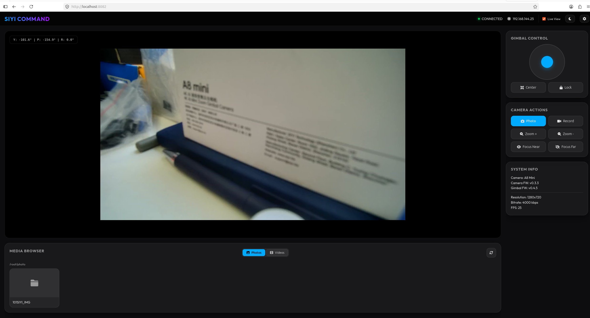

# Embedded Web UI Dashboard (`siyi-web`)

`siyi-sdk-go` includes a complete, self-contained embedded real-time web dashboard for gimbal control, live telemetry monitoring, video streaming, camera/gimbal configuration, and media management.



---

## 1. Features

- **Embedded Assets**: HTML, CSS, JavaScript, and icons are compiled directly into the binary using Go `embed.FS`. No external web assets or Node runtime needed.
- **Real-Time Telemetry**: 10Hz live WebSocket feed broadcasting gimbal yaw, pitch, and roll angles.
- **Interactive Controls**:
  - Gimbal virtual joystick for pan and tilt rate control.
  - One-key recentering, Lock, Follow, and FPV mode buttons, plus target Yaw/Pitch attitude control.
  - Zoom in, zoom out, and manual/auto focus buttons.
  - Photo capture, HDR toggle, and video recording toggle.
- **Configuration & Payload Settings**:
  - Stream encoding (Main/Sub/Recording, H.264/H.265, 4K/2K/1080P/720P, bitrate).
  - File naming schema (Index / Timestamp), MAVLink/HDMI OSD toggle, video stitching mode (ZT30/ZT6).
  - Weak control mode, UTC time synchronization, SD card format, and camera/gimbal soft reboot.
  - Laser ranging readout, thermal palette & shutter calibration, and AI tracking stream toggle.
- **RTSP Video Proxy**: Live RTSP-to-MJPEG video stream proxy (`ffmpeg` over TCP, auto-detecting old-gen vs new-gen RTSP URLs).
- **Media Gallery**: Integrated browser for browsing and downloading photos and videos stored on the camera's TF card (port 82).

---

## 2. Running the Dashboard

### Via Pre-built Binary or `go run`

```bash
# Build and run
go run ./cmd/siyi-web -ip 192.168.144.25 -port 8082
```

### Via Makefile

```bash
make run-web
```

Open your browser at `http://localhost:8082`.

---

## 3. Command Line Flags

| Flag       | Default          | Description                     |
| ---------- | ---------------- | ------------------------------- |
| `-ip`      | `192.168.144.25` | Target gimbal camera IP address |
| `-port`    | `8082`           | Local HTTP web server port      |
| `-v`       | `false`          | Print version and exit          |
| `-version` | `false`          | Print version and exit          |

---

## 4. REST & WebSocket Endpoints

| Endpoint                 | Method        | Description                                                                 |
| ------------------------ | ------------- | --------------------------------------------------------------------------- |
| `/`                      | `GET`         | Main Web UI single-page dashboard                                           |
| `/ws/attitude`           | `GET`         | WebSocket connection for 10Hz attitude telemetry                            |
| `/api/stream/video`      | `GET`         | MJPEG video stream proxy (`multipart/x-mixed-replace`)                      |
| `/api/stream/toggle`     | `POST`        | Enable/disable RTSP stream (`?enabled=true\|false` or `{"enable": bool}`)   |
| `/api/config/ip`         | `GET`, `POST` | Get or switch target camera IP (`{"ip": "192.168.144.25"}`)                 |
| `/api/system/info`       | `GET`         | Camera type and camera/gimbal/zoom firmware versions                        |
| `/api/settings`          | `GET`         | Unified snapshot of all current gimbal, camera, stream, and payload settings |
| `/api/system/ip`         | `GET`, `POST` | Read or set camera static IP, mask, and gateway (`0x81`/`0x82`)             |
| `/api/system/time`       | `GET`, `POST` | Read system time (`0x40`) or sync UTC time from host (`0x30`)               |
| `/api/system/reboot`     | `POST`        | Soft reboot camera and/or gimbal (`{"camera": true, "gimbal": false}`)      |
| `/api/storage/format`    | `POST`        | Format SD card (`0x48`)                                                     |
| `/api/gimbal/rotate`     | `POST`        | Gimbal velocity control (`{"yaw": 20, "pitch": -10}`)                       |
| `/api/gimbal/center`     | `POST`        | One-key gimbal centering (`0x08`)                                           |
| `/api/gimbal/mode`       | `GET`, `POST` | Get or set gimbal motion mode (`{"mode": "lock"\|"follow"\|"fpv"}`)         |
| `/api/gimbal/attitude`   | `GET`, `POST` | Get or set target gimbal yaw/pitch (`{"yaw": 0, "pitch": -30}`)             |
| `/api/gimbal/weak`       | `GET`, `POST` | Get/set weak control mode, control mode, and motor voltage                  |
| `/api/camera/photo`      | `POST`        | Capture photo (`0x0C`)                                                      |
| `/api/camera/record`     | `POST`        | Video recording start/stop toggle (`0x0C`)                                  |
| `/api/camera/capture`    | `POST`        | Generic `0x0C` action (`{"func": 0..10}`, e.g. `1` = HDR toggle)            |
| `/api/camera/zoom`       | `POST`        | Zoom control (`?direction=1\|-1\|0`)                                        |
| `/api/camera/focus`      | `POST`        | Focus control (`?direction=1\|-1\|0`)                                       |
| `/api/camera/encoding`   | `GET`, `POST` | Get (`?stream=0\|1\|2`) or set stream codec, resolution, and bitrate        |
| `/api/camera/picname`    | `GET`, `POST` | Get/set SD card file naming schema (`1`=Index, `2`=Timestamp)               |
| `/api/camera/osd`        | `GET`, `POST` | Get/set MAVLink / HDMI OSD overlay (`{"enabled": true\|false}`)             |
| `/api/camera/stitching`  | `GET`, `POST` | Get/set video stitching mode (`0..8`) on multi-sensor cameras               |
| `/api/laser`             | `GET`, `POST` | Read laser distance & target GPS, or toggle laser ranging (`0x32`)          |
| `/api/thermal`           | `GET`, `POST` | Read/set thermal palette, output mode, gain, global temp, or shutter        |
| `/api/ai`                | `GET`, `POST` | Read AI mode/stream status or toggle AI tracking stream output (`0x51`)     |
| `/api/media/directories` | `GET`         | List media directories on TF card (`?type=0` photos, `?type=1` videos)      |
| `/api/media/files`        | `GET`         | List all files in directory (`?type=0\|1&path=101SIYI_IMG`)                 |
| `/api/media/download`     | `GET`         | Proxy download for TF card files (`?url=...`)                               |
| `/api/media/download-all` | `GET`         | Download `.zip` archive of all photos (`?type=0`), videos (`?type=1`), or both (`?type=all`) |
