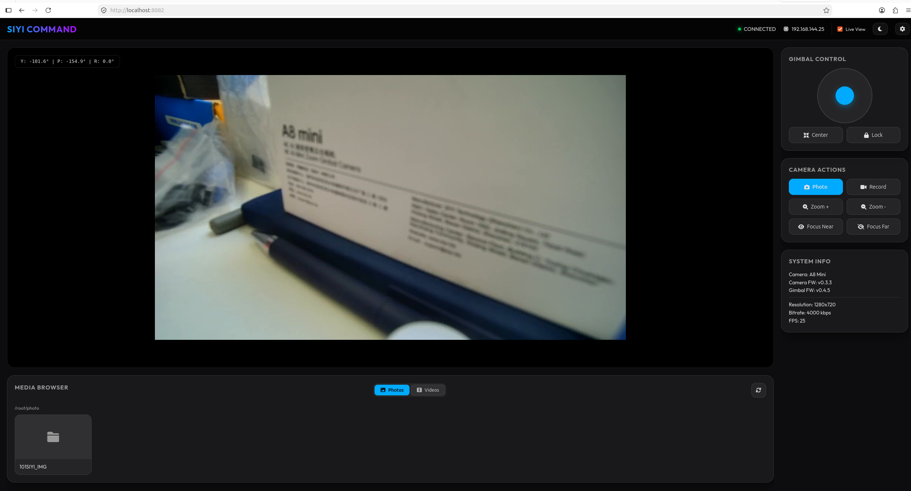

# Embedded Web UI Dashboard (`siyi-web`)

`siyi-sdk-go` includes a complete, self-contained embedded real-time web dashboard for gimbal control, live telemetry monitoring, video streaming, and media management.



---

## 1. Features

- **Embedded Assets**: HTML, CSS, JavaScript, and icons are compiled directly into the binary using Go `embed.FS`. No external web assets or node runtime needed.
- **Real-Time Telemetry**: 10Hz live WebSocket feed broadcasting gimbal yaw, pitch, roll angles and rotation speeds.
- **Interactive Controls**:
  - Gimbal virtual joystick for pan and tilt rate control.
  - One-key recentering, forward look, and downward look buttons.
  - Zoom in, zoom out, and absolute optical zoom slider.
  - Far and near focus buttons with touch-to-focus coordinate selection.
  - Shutter button for photo capture and video recording toggle.
- **RTSP Video Proxy**: Live RTSP-to-MJPEG video stream proxy for web browsers.
- **Media Gallery**: Integrated browser for browsing and downloading images/videos stored on the camera's TF card (port 82).

---

## 2. Running the Dashboard

### Via Pre-built Binary or `go run`

```bash
# Build and run
go run ./cmd/siyi-web -ip 192.168.144.25 -port 8080
```

### Via Makefile

```bash
make run-web
```

Open your browser at `http://localhost:8080`.

---

## 3. Command Line Flags

| Flag          | Default          | Description                                                    |
| ------------- | ---------------- | -------------------------------------------------------------- |
| `-ip`         | `192.168.144.25` | Target gimbal camera IP address                                |
| `-port`       | `8080`           | Local HTTP web server port                                     |
| `-udp-port`   | `37260`          | Camera UDP command port                                        |
| `-rtsp-port`  | `8554`           | Camera RTSP video port                                         |
| `-media-port` | `82`             | Camera TF card HTTP media port                                 |
| `-gen`        | `new`            | Camera generation: `new` (ZT30/ZT6) or `old` (ZR30/ZR10/A8/A2) |

---

## 4. REST & WebSocket Endpoints

| Endpoint                 | Method | Description                                                             |
| ------------------------ | ------ | ----------------------------------------------------------------------- |
| `/`                      | `GET`  | Main Web UI single-page dashboard                                       |
| `/ws`                    | `GET`  | WebSocket connection for 10Hz attitude telemetry                        |
| `/video_feed`            | `GET`  | MJPEG video stream proxy                                                |
| `/api/info`              | `GET`  | Camera and gimbal firmware versions, hardware ID                        |
| `/api/attitude`          | `GET`  | Instantaneous gimbal Euler angles and rates                             |
| `/api/rotate`            | `POST` | Gimbal velocity control (`{"yaw": 20, "pitch": -10}`)                   |
| `/api/center`            | `POST` | Gimbal centering command                                                |
| `/api/capture`           | `POST` | Photo capture (`{"action": "photo"}`)                                   |
| `/api/record`            | `POST` | Video recording start/stop toggle                                       |
| `/api/zoom`              | `POST` | Zoom control (`{"action": "in"\|"out"\|"stop"\|"set", "value": 2.5}`)   |
| `/api/focus`             | `POST` | Focus control (`{"action": "far"\|"near"\|"auto", "x": 960, "y": 540}`) |
| `/api/media/directories` | `GET`  | List media directories on TF card                                       |
| `/api/media/files`       | `GET`  | List files within directory (`?path=photo/20260315`)                    |
| `/api/media/download`    | `GET`  | Proxy download for TF card files                                        |
